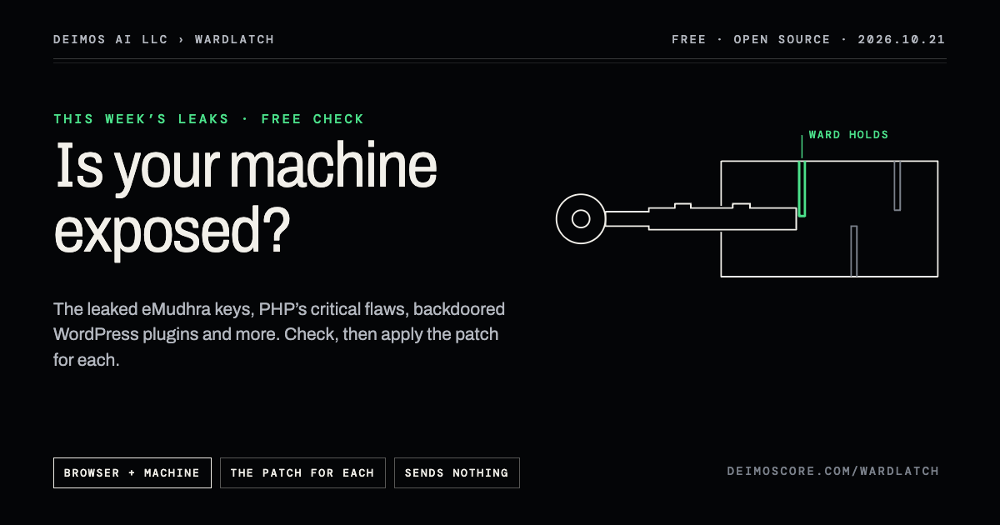
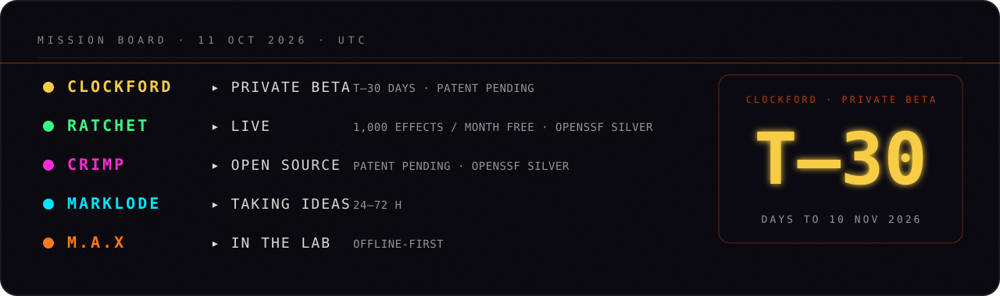
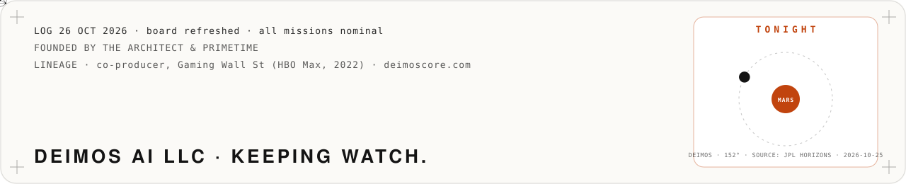

<h3 align="center">Mission control for AI agents.</h3>

<a href="https://deimoscore.com"><b>Deimos AI LLC</b></a> builds the controls that keep people in charge of what their AI agents do: seen, approved, stoppable and provable. 
<a href="https://github.com/deimos-hq/wardlatch"><b>Wardlatch</b></a>: free, open-source check for this month's leaks and exploited flaws, run on your own machine; sends nothing ·
<a href="https://clockford.com"><b>Clockford</b></a>: see, approve and stop your AI agents from your phone, whichever company built them. Patent pending; private beta 10 Nov 2026 ·
<a href="https://ratchetgate.com"><b>Ratchet</b></a>: the effect gate for AI agents; a retried charge, deploy or email happens at most once ·
<a href="https://github.com/thearchitect0x-glitch/crimp"><b>Crimp</b></a>: open-source decision gate; the decision withdraws itself when a fact breaks ·
<a href="https://marklode.com"><b>Marklode</b></a>: startup due diligence before the pitch, in 24–72 h ·
<a href="https://deimoscore.com"><b>M.A.X</b></a>: offline-first behavioral analysis for litigation teams. 
AI agent security · agent governance · human-in-the-loop approval · AI guardrails · OpenSSF Best Practices Silver (Ratchet, Crimp)

<h3 align="center">Free now: Wardlatch</h3>

On a computer with Node.js: <code>npx wardlatch@latest</code> 
SAFE only when a program on your machine was asked and refused · EXPOSED when it accepted · UNKNOWN when it couldn't be asked, never rounded up to SAFE 
<a href="https://www.deimoscore.com/wardlatch/">How it works</a> · <a href="https://github.com/deimos-hq/wardlatch">Source</a> · <a href="https://www.npmjs.com/package/wardlatch">npm</a> · <a href="https://github.com/deimos-hq/wardlatch/releases/latest">Latest release</a> · <a href="https://github.com/deimos-hq/wardlatch/security/advisories">Advisories, including our own</a> · <a href="https://www.deimoscore.com/wardlatch/mac/">The Mac fix</a>

    

<picture><source media="(prefers-color-scheme: dark)" srcset="assets/rules-dark.svg"></picture><a href="https://clockford.com"><picture><source media="(prefers-color-scheme: dark)" srcset="assets/boarding-dark.svg"></picture></a><picture><source media="(prefers-color-scheme: dark)" srcset="assets/log-dark.svg"></picture>

<b>Founded by <a href="https://github.com/thearchitect0x-glitch">The Architect</a> &amp; PrimeTime</b> · <a href="https://deimoscore.com">deimoscore.com</a> · Deimos AI LLC · keeping watch

Follow Deimos AI LLC: <a href="https://www.deimoscore.com">deimoscore.com</a> · <a href="https://x.com/DeimosAiLLC">X</a> · <a href="https://www.facebook.com/deimosaillc">Facebook</a> · <a href="https://www.instagram.com/deimosaillc/">Instagram</a> · <a href="https://www.linkedin.com/company/deimoshq/">LinkedIn</a>

